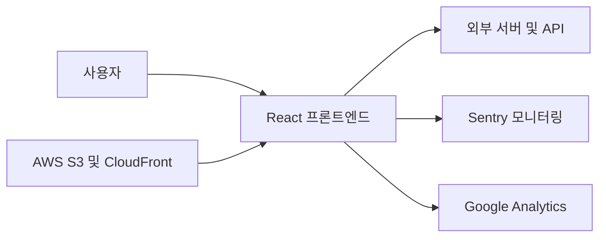

# 💌 Catch-Letter

<p align="center"></p>

> 그림으로 마음을 전하는 비밀 편지

<p align="center">🔗 <a href="https://catchletter.kr/">Catch-Letter 서비스</a></p>

<br>

## 📖 서비스 소개

친구들에게 그림으로 마음을 전할 수 있는 익명 우체통 서비스예요.

가볍게 웃기고 싶을 때, 고마운 마음을 전하고 싶을 때, 혹은 조금 어색한 친구와도 부담 없이 소통하고 싶을 때 쓰면 좋아요.

- 가입 없이 바로 쓸 수 있어요
- 회사나 학교에서도 가볍게 즐길 수 있어요
- 그림을 맞혀야만 편지를 볼 수 있어서 게임처럼 재미있게 즐길 수 있어요

<br>

## 📱 사용 방법

1️⃣ 우체통 만들기 - 나만의 우체통 이름을 정하고 비밀번호를 설정해요.

<br>

2️⃣ 친구들에게 공유하기 - 친구들에게 우체통 링크를 SNS나 문자 등으로 공유해주세요.

<br>

3️⃣ 친구의 그림 편지 - 그림과 편지를 함께 남겨요.

<br>

4️⃣ 그림 맞히고 편지 열기 - 그림의 정답을 맞혀야만 친구의 편지를 볼 수 있어요.

<br>

## 🛠️ 기술 스택

### 🛠️ Tech Stack

- React, TypeScript, Vite
- TanStack Query, Axios, Zustand
- Emotion
- Konva, Matter.js
- i18next

<br>

### 📈 Monitoring

- Sentry
- Google Analytics

<br>

### ⚙️ Dev Tools

- ESLint, Prettier
- GitHub Actions, AWS S3, CloudFront

<br>

## ✨ 주요 기능 상세

### 📮 우체통 생성
- 나만의 우체통 이름 설정 및 비밀번호 입력
- 우체통 링크 생성 및 클립보드 복사

<br>

### 🎨 그림 편지 작성
- 캔버스를 활용한 자유로운 드로잉 및 그림 작성
- 편지 내용 작성 및 익명 전송

<br>

### 🧩 정답 맞히기
- 친구가 그린 그림의 정답 추측
- 정답 입력 시 편지 내용 확인 가능

<br>

## 🏗️ 시스템 아키텍처



<br>

## 📅 개발 기간

2024-12-20 ~ 2026-08-13

<br>

## 📁 폴더 구조

```text
📦 
 ┣ 📂 .github/ (워크플로우 및 이슈 템플릿 파일)
 ┣ 📂 .storybook/ (스토리북 설정 파일)
 ┣ 📂 docs/ (문서 파일)
 ┣ 📂 src/
 ┃ ┣ 📂 api/ (API 호출 함수)
 ┃ ┣ 📂 app/ (앱 전역 설정 및 모델)
 ┃ ┣ 📂 assets/ (이미지 및 폰트 에셋)
 ┃ ┣ 📂 components/ (공통 및 기능별 컴포넌트)
 ┃ ┣ 📂 hooks/ (커스텀 훅)
 ┃ ┣ 📂 pages/ (페이지 컴포넌트)
 ┃ ┣ 📂 shared/ (공유 유틸 및 UI)
 ┃ ┣ 📂 store/ (상태 관리 스토어)
 ┃ ┣ 📂 styles/ (스타일 파일)
 ┃ ┗ 📂 types/ (타입 정의)
 ┗ 📜 package.json
```

<br>

## 👩🏻‍💻 팀원

| FE | FE | FE | BE | Contributor |
| :---: | :---: | :---: | :---: | :---: |
| **김수민** | **박지영** | **손성오** | **유남균** | **kimpra** |
| <br>[@ssuminii](https://github.com/ssuminii) | <br>[@jizerozz](https://github.com/jizerozz) | <br>[@Sonseongoh](https://github.com/Sonseongoh) | <br>[@namgyun1201](https://github.com/namgyun1201) | <br>[@kimpra2989](https://github.com/kimpra2989) |

<br>

## 📋 역할 분담

### 김수민
- AWS S3 배포 워크플로우 설정 및 Sentry API 에러 레벨 분류 추가
- 편지함 자동 새로고침 및 낙관적 업데이트 적용
- 리드미 문서 업데이트 및 캔버스 스타일 수정

<br>

### 박지영
- 비밀번호 입력 인풋 숨김 처리 상태 분리 및 렌더링 버그 해결
- 소셜 공유 모달 아이콘 스켈레톤 UI 적용 및 폰트 preload 설정
- 이벤트 모달 및 알림 기능 구현

<br>

### kimpra
- 액세스 토큰 저장 공간을 세션스토리지로 수정
- 튜토리얼 모달 캐러셀 기능 구현
- separated input 컴포넌트의 유효성 검사 및 키보드 이동 로직 개선

<br>

### 손성오
- 타이머 리렌더링 최적화 및 힌트 노출 로직 변경
- separated input 백스페이스 및 패딩 속성 수정
- 정답 입력 및 힌트 관련 UI 버그 수정

<br>

## 🚀 시작하기

```bash
npm install
npm run dev
```