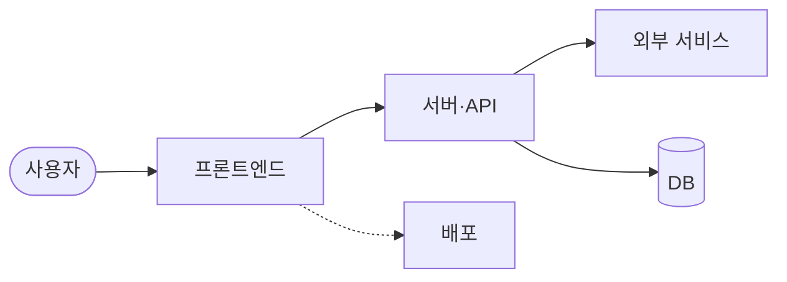

# React

<p align="center">🔗 <a href="https://react.dev">React 서비스</a></p>

> 웹과 네이티브 사용자 인터페이스를 만들기 위한 자바스크립트 라이브러리예요

<br>

## 💡 서비스 소개

사용자 인터페이스를 효율적이고 직관적으로 구축하고 싶은 개발자가 웹 및 모바일 애플리케이션을 개발할 때 사용하기 좋아요.

- 애플리케이션의 각 상태에 맞는 간단한 뷰를 설계하여 상호작용하기 쉬운 UI를 만들 수 있어요
- 자체 상태를 관리하는 컴포넌트를 조합하여 복잡한 사용자 인터페이스를 구축할 수 있어요
- 기존 기술 스택을 크게 변경하지 않고 새로운 기능을 점진적으로 개발할 수 있어요

<br>

## 🚀 사용 방법

1️⃣ 프로젝트에 React 라이브러리를 설치해요.

2️⃣ 컴포넌트 파일을 생성하고 JSX를 활용해 UI를 작성해요.

3️⃣ 루트 컨테이너에 컴포넌트를 렌더링하여 화면에 출력해요.

```jsx
import { createRoot } from 'react-dom/client';

function HelloMessage({ name }) {
  return <div>Hello {name}</div>;
}

const root = createRoot(document.getElementById('container'));
root.render(<HelloMessage name="Taylor" />);
```

<br>

## 🛠️ 기술 스택

### 💻 Core & Dev Tools
- JavaScript, TypeScript, Babel, Rollup, ESLint, Prettier, Jest

<br>

## ✨ 주요 기능 상세

- 컴포넌트 기반 UI 설계
- 선언적 뷰 및 상태 관리
- 서버 사이드 렌더링 지원

<br>

## 📊 시스템 아키텍처



<br>

## 📅 개발 기간

2013-05-24 ~ 2026-10-06

<br>

## 📁 폴더 구조

```text
📦 
 ┣ 📂 .github/ (워크플로우 및 이슈 템플릿 파일)
 ┣ 📂 compiler/ (컴파일러 관련 소스 및 앱)
 ┣ 📂 packages/ (코어 패키지 및 렌더러 소스)
 ┗ 📂 scripts/ (빌드 및 테스트 스크립트)
```

<br>

## 👥 팀원

| Contributor | Contributor | Contributor | Contributor | Contributor |
| :---: | :---: | :---: | :---: | :---: |
| **Sebastian Markbåge** | **Paul O’Shannessy** | **dan** | **Andrew Clark** | **Sophie Alpert** |
| <br>[@sebmarkbage](https://github.com/sebmarkbage) | <br>[@zpao](https://github.com/zpao) | <br>[@gaearon](https://github.com/gaearon) | <br>[@acdlite](https://github.com/acdlite) | <br>[@sophiebits](https://github.com/sophiebits) |

| Contributor |
| :---: |
| **Joseph Savona** |
| <br>[@josephsavona](https://github.com/josephsavona) |

<br>

## 📋 역할 분담

### Sebastian Markbåge
- 파이버 마운트 상태 확인 로직 및 제스처 애니메이션 이벤트 정리
- Flight 관련 프로미스 사이클 및 서버 함수 패치 처리
- 서스펜스 경계 및 뷰 트랜지션 이름 최적화

### Paul O’Shannessy
- 기여 서약 및 행동 강령 문서 업데이트
- 릴리스 프로세스 명령어 및 버전 관리 스크립트 수정
- 빌드 및 테스트 관련 설정 정리

### dan
- Flight 문자열 중복 제거 및 디버그 정보 개선
- 파이버 및 벤치마크 관련 버그 수정
- 불필요한 propTypes 검증 및 레거시 설정 제거

### Andrew Clark
- 무한 루프 및 에러 복구 관련 버그 수정
- Flight 서버 참조 및 전환 관련 플래그 활성화
- 컨텍스트 전파 및 서스펜스 경계 처리 개선

### Sophie Alpert
- 외부 저장소 뮤테이션 감지 및 입력 값 업데이트 수정
- Fast Refresh 관련 리마운트 및 핫 리로딩 최적화
- 하이드레이션 및 에러 메시지 개선

### Joseph Savona
- React 컴파일러 Rust 포팅 및 결함 허용(fault tolerance) 인프라 추가
- 컴파일러 파이프라인 에러 수집 및 유효성 검사 패스 업데이트
- 테스트 픽스처 및 문서 정리

<br>

## 🏁 시작하기

```bash
yarn install
yarn run build
```